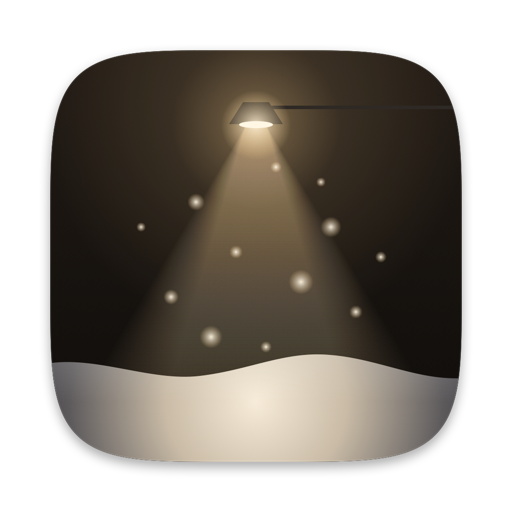

<p align="center">
  
</p>

<h1 align="center">GooogeR Snowhush</h1>

<p align="center">
  <strong>Зимняя атмосфера прямо на рабочем столе macOS.</strong>
</p>

<p align="center">
  <a href="https://github.com/GooogeR/snowhush/releases/latest">
    <strong>Скачать для macOS</strong>
  </a>
  &nbsp;·&nbsp;
  <a href="https://t.me/goooger">
    Поддержать наш проект
  </a>
</p>

<p align="center">
  <sub>Независимая модификация Snowhush · macOS 14 и новее</sub>
</p>

---

## О проекте

**GooogeR Snowhush** — наша модифицированная версия Snowhush, которая добавляет зимнее настроение на рабочий стол Mac.

Снег мягко падает поверх рабочего стола, постепенно образует сугробы, а небольшая снегоуборочная машина периодически расчищает снег. В правом нижнем углу рабочего стола расположена новогодняя ёлка: она остаётся на своём месте и не должна перекрывать окна открытых приложений.

Проект развивается независимо: мы адаптируем интерфейс, добавляем собственные элементы и готовим отдельный канал распространения и обновлений.

## Возможности

- **Снег на рабочем столе.** Анимированный снег создаёт зимнюю атмосферу.
- **Снегоуборочная машина.** Машина проезжает по нижней части экрана и расчищает снег.
- **Новогодняя ёлка.** Расположена в правом нижнем углу рабочего стола, позади окон приложений.
- **Музыка.** Звуковое сопровождение связано с ручным запуском очистки снега.
- **Меню на нескольких языках.** Интерфейс включает русский, английский, немецкий, испанский, французский, японский, португальский, украинский и китайский языки.
- **Поддержка проекта.** Пункт меню ведёт на [Telegram](https://t.me/goooger).

> Некоторые детали поведения и доступность функций могут меняться от версии к версии.

## Установка на macOS

1. Откройте раздел [Releases](https://github.com/GooogeR/snowhush/releases).
2. Скачайте `Snowhush.dmg` из последнего релиза.
3. Откройте DMG-файл.
4. Перетащите Snowhush в папку **Applications**.
5. Запустите приложение.

### Важно о безопасности macOS

Локальные сборки без сертификата Apple Developer ID и нотарификации могут показывать предупреждение Gatekeeper. Это ограничение способа подписи и распространения, а не подтверждение наличия вредоносного кода. Не устанавливайте приложение из непроверенных источников; используйте только релизы из этого репозитория.

## Сборка из исходников

Для локальной сборки потребуются macOS, Xcode и Command Line Tools.

```bash
git clone https://github.com/GooogeR/snowhush.git
cd snowhush

./build.sh
```

Готовое приложение появится в `build/Snowhush.app`.

Чтобы создать DMG для локального тестирования:

```bash
./make-dmg-local.sh
```

Готовый образ появится в `dist/Snowhush.dmg`.

Локальный DMG собирается с ad-hoc подписью. Для распространения без предупреждений Gatekeeper потребуется сертификат Developer ID Application и нотарификация Apple.

## Обновления

Планируем распространять обновления macOS через GitHub Releases этого репозитория:

[github.com/GooogeR/snowhush/releases](https://github.com/GooogeR/snowhush/releases)

Поддержка Sparkle настраивается для отдельного канала обновлений GooogeR Snowhush. Автоматические обновления будут доступны после публикации релизов с корректной подписью Sparkle и `appcast.xml`.

## Поддержать наш проект

Если тебе нравится GooogeR Snowhush и ты хочешь поддержать его развитие, будем рады видеть тебя в нашем Telegram:

<p align="center">
  <a href="https://t.me/goooger"><strong>t.me/goooger</strong></a>
</p>

## Авторство и лицензия

GooogeR Snowhush — независимая модификация проекта **Snowhush** авторства [Mykhailo Bezruchko](https://github.com/mbezruchko/Snowhush).

Мы сохраняем авторство оригинального проекта и условия его лицензии. Исходный проект распространяется под лицензией [PolyForm Noncommercial 1.0.0](LICENSE). Она разрешает использование, распространение и модификацию в пределах её условий, но не разрешает коммерческое использование.

Перед распространением модифицированной версии ознакомьтесь с полным текстом лицензии в файле [`LICENSE`](LICENSE).

---

<p align="center">
  Made with ❄️ by <a href="https://github.com/GooogeR">GooogeR</a>
</p>
